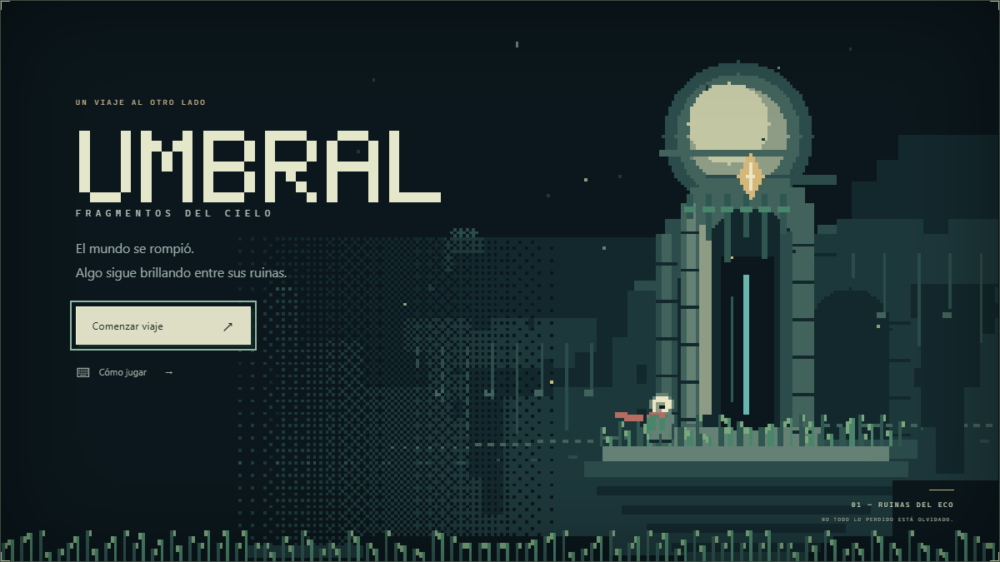
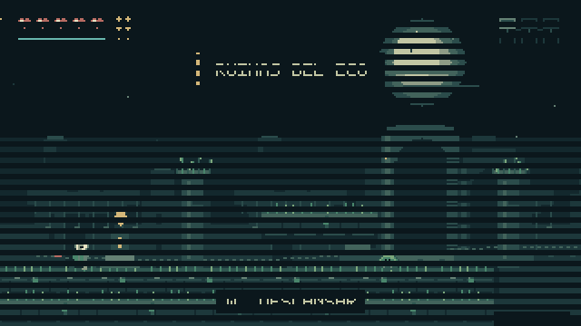

# UMBRAL — Fragmentos del cielo

Una aventura de acción y exploración entre mundos rotos. Eres una exploradora que sigue la última luz a través de ruinas, cavernas de cristal y una ciudad suspendida. Encuentra las dos mejoras, abre los umbrales y vence al Último Vigía.



## Jugar

Necesitas **Node.js 20 o posterior** y un navegador de escritorio con teclado. No hay dependencias que instalar ni compilación previa.

```sh
git clone https://github.com/BelkiErick/umbral-fragmentos-del-cielo.git
cd umbral-fragmentos-del-cielo
npm start
```

Abre **http://localhost:4173**. Para cerrar el servidor, pulsa `Ctrl+C` en la terminal. `npm run dev` hace lo mismo. También puedes servir la carpeta con cualquier servidor estático que soporte módulos JavaScript; abrir `index.html` con `file://` no funciona por las restricciones del navegador.

El código, el arte y el sonido se ejecutan localmente. No se utilizan CDN, fuentes remotas, cuentas ni servicios externos. No hace falta conexión a Internet después de instalar Node.js. El botón de la esquina inferior derecha activa pantalla completa.

## Gameplay



Captura de la simulación y el renderizador del juego, con una secuencia automática de controles. Recorre la campaña completa sin modificar posiciones, vida ni mejoras. GIF a 10 FPS; el juego simula a 60 Hz. Es una aventura breve de seis salas; puedes retroceder por todos los umbrales abiertos y continuar explorando después del final.

## Controles

| Acción | Teclas |
|---|---|
| Moverse | A/D o ←/→ |
| Dirección del dash | WASD o flechas, incluidas diagonales |
| Saltar | Espacio; mantener para llegar más alto |
| Dash | Shift, con invulnerabilidad durante el desplazamiento |
| Espada | J o Z |
| Proyectil | K o X |
| Cruzar un umbral / descansar | W o ↑, cerca del objeto |
| Pausar / reanudar | ESC |
| Menús | Ratón o Tab; ↑/↓ y Enter en menús del juego |

Los movimientos tienen aceleración rápida y frenado, **coyote time de seis pasos (100 ms)**, búfer de salto de seis pasos y salto de altura variable. Las plataformas finas se atraviesan al subir. El dash funciona en ocho direcciones: dura 10 pasos, se desplaza a 7,5 píxeles por paso y puede repetirse cada 48 pasos; la mejora lo extiende a 12 y reduce la recarga a 38.

## Mundo y progreso

| Bioma | Física | Enemigos | Descubrimiento |
|---|---|---|---|
| Ruinas del Eco | Gravedad normal | Acechador: patrulla y persecución; polilla: vuelo y picado | **Alas del eco**: un segundo salto en el aire, abre las cavernas |
| Cavernas de Cristal | Gravedad reducida | Saltador: saltos cargados; centinela: disparos dirigidos | **Dash resonante**: rompe barreras, daña enemigos y abre la ciudad |
| La Ciudad Suspendida | Viento periódico en el aire | Dron: vuelo oscilante y disparos; lancero: pausa y embestida | **Último Vigía**: abanicos de proyectiles, salto y carga |

Todos los enemigos entran en fase agresiva al llegar al **30% de HP**, con mayor velocidad o frecuencia de ataques. Al morir se desintegran en partículas y sueltan cargas. Los santuarios restauran los cinco corazones y las seis cargas de proyectil. Puedes usar la espada siempre; no consume munición.

El HUD muestra corazones, recarga del dash, cargas restantes y un minimapa: casillas oscuras sin explorar, claras exploradas, punto central para tu sala y un pequeño rombo dorado para el próximo objetivo. Las mejoras brillan en el mundo. Los avisos breves explican su habilidad al recogerlas.

## Guardado y ajustes

- Se guarda automáticamente al entrar en una sala, recoger mejoras, derrotar enemigos, romper barreras, descansar y pausar.
- Se conservan la sala, mejoras, exploración, enemigos derrotados, barreras rotas, final, tiempo y caídas. Al continuar o morir, reapareces en el inicio seguro de la sala con vida y munición restauradas. No se conserva la posición exacta ni cada proyectil.
- El guardado usa `localStorage` (`umbral-save-v1`): pertenece a ese navegador y al mismo origen/puerto. Borrar los datos del sitio elimina el progreso. Un guardado inválido se rechaza para permitir una partida nueva.
- Si el navegador bloquea el almacenamiento, puedes jugar durante la sesión y la barra indica **SIN GUARDADO**.
- Nuevo viaje pide confirmación antes de sustituir la partida. Continuar después de vencer al jefe permite recorrer el mundo ya restaurado.
- Scanlines CRT y viñeta son independientes. Se puede reducir la sacudida de cámara, silenciar y ajustar volumen. Los ajustes se conservan por separado. La preferencia de movimiento reducido del sistema se respeta inicialmente.
- El audio empieza tras pulsar Jugar, conforme a las restricciones de reproducción de los navegadores. Cambiar de pestaña o perder el foco pausa la partida y libera las teclas.

## Por qué estas herramientas

**JavaScript modular + Canvas 2D + Web Audio**, con un motor pequeño específico para esta aventura. Permite ajustar directamente la respuesta del salto y el dash, separar la simulación del dibujo y distribuir el juego como archivos estáticos sin instalaciones adicionales de motores. Godot sería una buena alternativa para una campaña más grande y exportaciones nativas; aquí el objetivo es una aventura completa, ligera y fácil de ejecutar.

La resolución interna es **320×180**, escalada con interpolación nearest-neighbor. Los sprites base y tiles usan una cuadrícula de **16×16**; el jefe ocupa varios tiles. Cada zona tiene **16 colores base**. Todo el arte está dibujado por código, incluida la fuente bitmap; los efectos CRT y viñeta se aplican fuera del canvas. La música chiptune y los efectos son sintetizados originales.

## Arquitectura

| Archivo | Responsabilidad |
|---|---|
| `src/main.js` | Bucle de tiempo fijo, escenas, menús accesibles, ajustes y coordinación del guardado |
| `src/input.js` | Teclas sostenidas frente a pulsaciones únicas; limpieza de entrada al perder foco |
| `src/simulation.js` | Jugador, combate, seis especies y jefe, mejoras, partículas y eventos de audio |
| `src/physics.js` | Colisiones AABB, subpasos de hasta 3 px y plataformas unidireccionales |
| `src/world.js` | Seis salas, tiles, conexiones, enemigos, mejoras y paletas/física por bioma |
| `src/render.js` | Cámara suavizada, parallax, entorno por capas, sprites, efectos y HUD |
| `src/art.js` | Primitivas pixel, sprites 16×16, tiles y fuente bitmap original |
| `src/audio.js` | Secuenciador chiptune y efectos mediante Web Audio |
| `src/save.js` | Serialización versionada, validación estructural y de progreso, almacenamiento tolerante a errores |
| `index.html` / `style.css` | Presentación, menús, diálogos, accesibilidad y pantalla completa |
| `scripts/server.mjs` | Servidor estático local, sin dependencias |

La simulación no importa el DOM: `createGame(save?)` crea el estado y `step(game, input)` avanza exactamente un paso. El adaptador del navegador usa `requestAnimationFrame` con acumulador a 60 Hz y limita las pausas largas a 100 ms. Los eventos de simulación alimentan el audio; el renderizador solo dibuja el estado. El guardado copia los datos persistentes, sin serializar entidades transitorias.

Los mapas son matrices de 40×15 tiles: `0` vacío, `1` piedra sólida, `2` plataforma fina y `4` barrera rompible. `roomInstance()` crea una copia y reaplica las barreras destruidas. Las posiciones y la física están en píxeles de la resolución interna, nunca en píxeles CSS.

## Verificación

```sh
npm test
node scripts/campaign.mjs
```

La suite comprueba movimiento, coyote time exacto, salto variable, plataformas, dash, proyectiles, daño e invulnerabilidad, fases enemigas, mejoras, portales, guardado inválido y una campaña completa controlada por entradas.

La prueba opcional de navegador usa Playwright (solo desarrollo):

```sh
npm install --no-save playwright
npx playwright install chromium
# Con npm start ejecutándose en otra terminal:
node tests/browser.mjs
```

Se comprobó en Microsoft Edge/Chromium: teclado, movimiento, salto, dash, proyectil, pausa, pérdida de foco, ajustes, guardado, almacenamiento bloqueado, diálogos y diseño a 390 px. No se ha verificado Firefox/Safari, mandos ni controles táctiles. El diseño móvil permite ver el juego y su información, pero la aventura requiere teclado.

Para regenerar el GIF (requiere Playwright y Python con Pillow, únicamente herramientas de desarrollo):

```sh
node scripts/capture.mjs
python scripts/make_gif.py
```

Puedes indicar `PLAYWRIGHT_CHANNEL=msedge` para usar Edge instalado, o `NODE_PATH` para resolver una instalación existente de Playwright. Las capturas intermedias se guardan en `.artifacts/`, excluida de Git.

## Créditos

Pixel art original dibujado por código, música chiptune y efectos sintetizados con Web Audio. Inspiración de movimiento y atmósfera: **Celeste, Cave Story y Hyper Light Drifter**. No se han reutilizado sus personajes, gráficos, música ni mapas.
